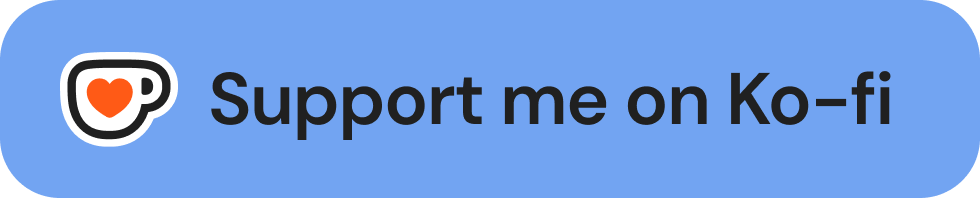
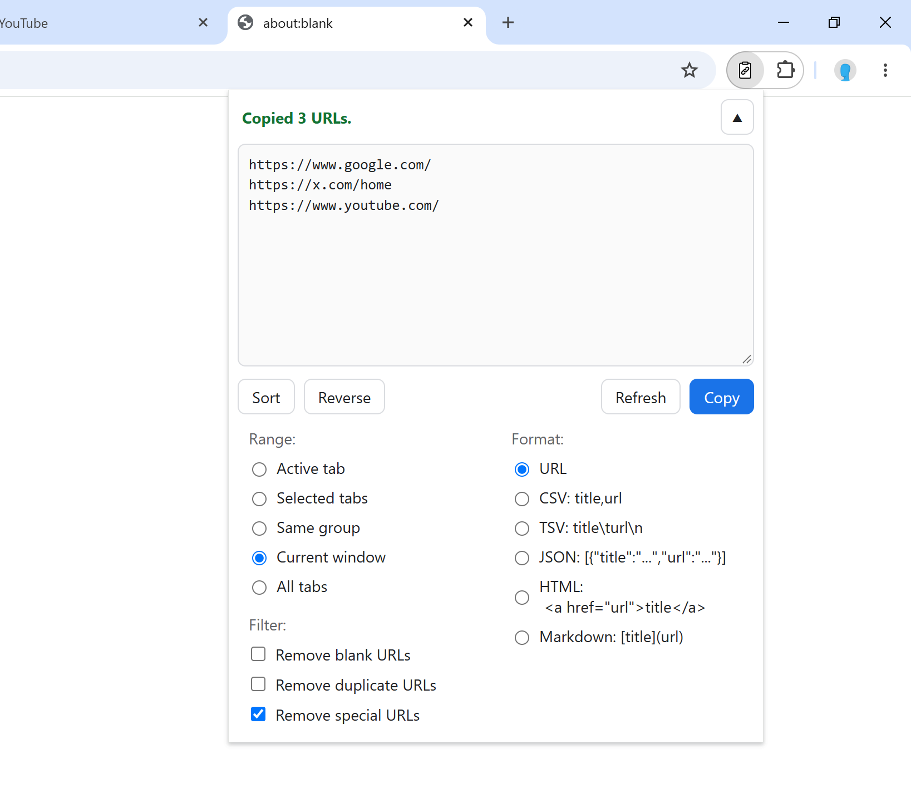

# Quick URL Copy

<a href="https://ko-fi.com/snowflake36u" target="_blank"></a>

<picture>
  
</picture>

Chrome extension for quickly copying URLs from open tabs. Copy with a keyboard shortcut or a single click on the action button, or fine-tune the collection range and output format on the popup.

## Features

- **Quick copy with minimal operations:** Keyboard shortcuts for each collection range, and an action button that copies on click.
- **User-friendly popup:** Foldable detail options for low visual stress, and highlighted messages notifying the result of each action.
- **Flexible collection range:** Interactively switchable between active tab, selected tabs, same tab group, current window, or all tabs.
- **Multiple output formats:** URL list, TSV, CSV, JSON, Markdown, and HTML.
- **Built-in URL filters:** Blank, duplicate, and non-web URLs are excluded automatically.
- **Privacy-friendly:** No host permissions are requested, and page contents are never read.

## Usage

### Collection ranges

| Range | Collected tabs |
| --- | --- |
| Active tab | The active tab only |
| Selected tabs | The tabs currently selected (highlighted) in the current window |
| Same tab group | All tabs in the tab group of the current window |
| Current window | All tabs in the current window |
| All tabs | All tabs in all windows |

Each range has its own keyboard shortcut. Clicking the action button copies with the default range configured in the settings.

### Popup

- Change the collection range and output format interactively.
- **Sort / Reverse**: rearrange the collected URL list.
- **Refresh / Copy**: refresh the list and copy it manually after changing options.
- A highlighted message shows the result of each action.
- Fold the popup to hide the detail options.

### URL filters

It provides options to filter following urls:

- Blank URLs
- Duplicate URLs
- Special URLs such as `chrome://`, `about:`, `data:`, `file:`, and similar non-web URLs

### Settings

- The popup remembers the last-used execution settings automatically.
- The default collection range used by the action button can be configured.

## Output formats

| Type | Explanation |
| --- | --- |
| `url` | one URL per line |
| `tsv` | `title\turl` per line |
| `csv` | `title,url` per line |
| `json` | `[ { "title": "...", "url": "..." }, ... ]` |
| `markdown-link` | `[title](url)` per line |
| `html-link` | `<a href="url">title</a>` per line |

## Project links

- Repository: https://github.com/snowy-tools/chrome-quick-url-copy
- Privacy policy source: `store/privacy-policy.md`
- Support: https://github.com/snowy-tools/chrome-quick-url-copy/issues

## Install for local development

1. Clone the repository:

```bash
git clone https://github.com/snowy-tools/chrome-quick-url-copy
```

2. Open `chrome://extensions/`.
3. Enable **Developer mode**.
4. Click **Load unpacked**.
5. Select the `chrome-quick-url-copy` project directory.

## Release workflow

This repository separates normal development from release operations.

1. Push normal development commits to `master`.
2. When you are ready to start a release, run the `release-please` GitHub Actions workflow manually from the Actions tab.
3. `release-please` creates or updates a Release PR with the version bump, changelog, commit range, and package metadata for review.
4. Review the Release PR in GitHub. If anything looks wrong, fix the configuration or release metadata in a normal commit, push it, and rerun the `release-please` workflow.
5. When the Release PR looks correct, merge it into `master`.
6. The release is finalized by creating the GitHub Release. After that, the build workflow packages the Chrome extension and uploads the artifact to the release.

This avoids ad-hoc `chore: prepare release` / `chore: retry release` commits purely to test the release workflow.

## Notes

- The extension uses Manifest V3.
- It requests these permissions: `tabs`, `storage`, `clipboardWrite`, and `offscreen`.
- No host permissions are requested, and the extension uses Chrome's tabs API without reading page contents.
- Clipboard writes are handled through the offscreen document required by Manifest V3.
- Settings and recent collection state are stored in Chrome storage and reused for subsequent operations.
- The popup and background script share the same collection logic, so the current text area and the last action state stay in sync.